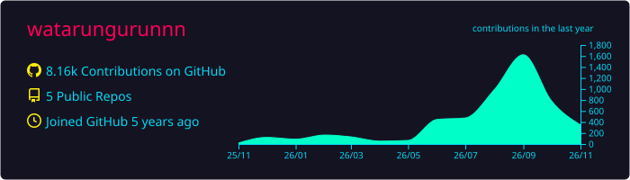
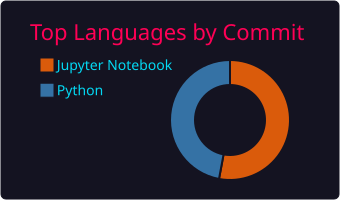
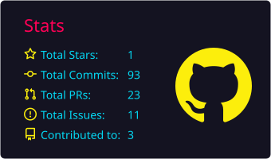
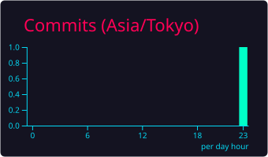

  
  
  

## Open source contributions
- **[PyTorch](https://github.com/pytorch/pytorch)** — MPS backend: fix float32 errors in `linalg.matrix_rank` / `linalg.pinv` ([#114771](https://github.com/pytorch/pytorch/pull/114771)), fix an inverted error message in `empty_mps` ([#115746](https://github.com/pytorch/pytorch/pull/115746))
- **[Google Summer of Code 2022](https://github.com/devoworm/GSoC-2022/tree/main/D-GNNs)** (DevoWorm) — GNN-based cell tracking for C. elegans development ([DevoGraph](https://github.com/LspongebobJH/DevoGraph)), fixes to [devolearn](https://github.com/DevoLearn/devolearn)

## Stats
<!--
  These cards are SVG files that .github/workflows/profile-summary-cards.yml regenerates every day
  into profile-summary-card-output/. They are read from this repository instead of a hosted card API,
  so they keep rendering when a shared public instance is unavailable (as of 2026-11 the public
  github-readme-stats and github-profile-trophy instances returned 503/402, which broke the old cards).
-->

